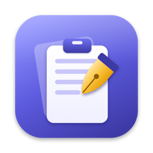
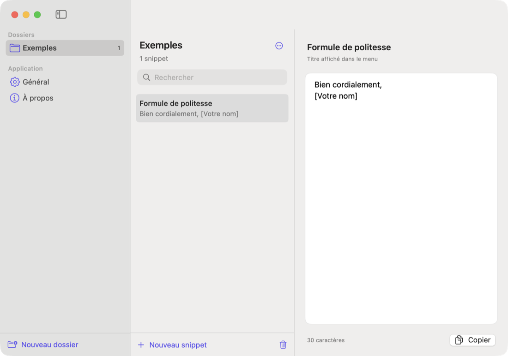
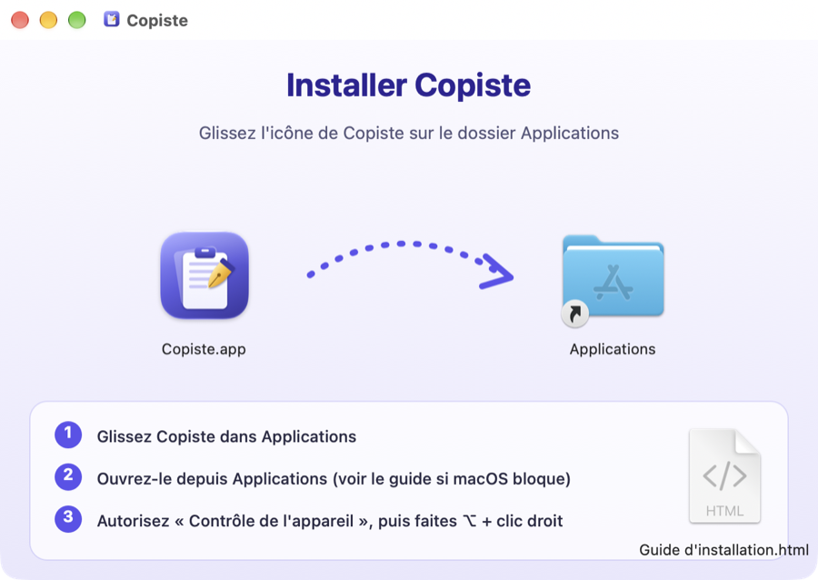

<p align="center">
  
</p>

<h1 align="center">Copiste</h1>

<p align="center">
  <b>Votre presse-papier, en mieux.</b><br>
  Un historique de ce que vous copiez et vos textes favoris rangés en dossiers,<br>
  à portée de <kbd>⌥ option</kbd> + clic droit, sur macOS.
</p>

<p align="center">
  <a href="../../releases/latest"><b>⬇️ Télécharger la dernière version</b></a> ·
  <a href="../../releases/latest">Guide d'installation</a> ·
  macOS 14+ · Apple Silicon et Intel · Licence MIT
</p>

---

<p align="center"></p>

## Fonctionnalités

- 🕘 **Historique du presse-papier** : les 30 derniers textes copiés, collés d'un clic ou avec les touches <kbd>1</kbd> à <kbd>9</kbd>.
- 📁 **Snippets rangés en dossiers** : signatures, réponses types, adresses… créés une fois, réutilisés partout.
- 🖱️ **Menu sous la souris** : <kbd>⌥</kbd> + clic droit dans n'importe quelle application, ou <kbd>⌥</kbd><kbd>⌘</kbd><kbd>V</kbd> au clavier. Le texte choisi est collé directement.
- 🔎 **Recherche, glisser-déposer, déplacement entre dossiers** dans une interface entièrement en français.
- 🔒 **Respect de la vie privée** : rien ne quitte votre Mac. L'historique reste en mémoire et les mots de passe des gestionnaires (1Password, Bitwarden…) sont ignorés.
- 🪶 **Léger** : environ 1 Mo, aucune dépendance, une simple icône dans la barre des menus.

## Installation

Téléchargez l'un des fichiers de la [dernière version](../../releases/latest) :

| Fichier | Pour qui |
|---|---|
| `Copiste-x.y.z.pkg` | Le plus simple : un assistant d'installation vous guide. |
| `Copiste-x.y.z.dmg` | Glissez Copiste dans le dossier Applications. |
| `Copiste-x.y.z.zip` | L'installeur .pkg et le guide, à envoyer par e-mail. |

<p align="center"></p>

> [!IMPORTANT]
> Copiste n'est pas encore notarisé par Apple. Au premier lancement, macOS peut afficher *« Apple n'a pas pu confirmer que “Copiste” ne contenait pas de logiciel malveillant »*. Cliquez sur **Terminé**, puis allez dans **Réglages Système › Confidentialité et sécurité** et cliquez sur **Ouvrir quand même**. Cette étape n'est nécessaire qu'une seule fois.

Ensuite, autorisez Copiste dans **Réglages Système › Confidentialité et sécurité › Contrôle de l'appareil** (« Accessibilité » sur les versions plus anciennes de macOS). Sans cette autorisation, Copiste ne peut pas coller à votre place.

Le [guide d'installation complet](../../releases/latest) (fichier `Guide d'installation.html`) détaille chaque étape, ainsi que le dépannage et la désinstallation. Il est aussi fourni dans le .dmg et le .zip.

## Utilisation

| Action | Raccourci |
|---|---|
| Ouvrir le menu sous la souris | <kbd>⌥ option</kbd> + clic droit |
| Ouvrir le menu au clavier | <kbd>⌥</kbd> <kbd>⌘</kbd> <kbd>V</kbd> |
| Coller l'un des 9 derniers éléments (menu ouvert) | <kbd>1</kbd> … <kbd>9</kbd> |
| Gérer les snippets | Icône de la barre des menus › Gérer les snippets… |

Les snippets sont enregistrés dans `~/Library/Application Support/Copiste/snippets.json`.

## Compiler depuis les sources

Seuls les outils en ligne de commande d'Apple sont nécessaires (`xcode-select --install`), pas Xcode.

```bash
./build.sh              # → build/Copiste.app (universel arm64 + x86_64)
./scripts/package.sh    # → dist/ : .pkg, .dmg, .zip et SHA256SUMS.txt
```

`build.sh` signe l'app avec votre certificat « Apple Development » s'il en trouve un, sinon avec une signature ad hoc. Avec une signature ad hoc, macOS retire l'autorisation « Contrôle de l'appareil » à chaque recompilation.

### Organisation du code

| Fichier | Rôle |
|---|---|
| `Sources/Copiste/AppDelegate.swift` | Démarrage, icône de la barre des menus, raccourcis |
| `Sources/Copiste/ClipboardHistory.swift` | Surveillance du presse-papier |
| `Sources/Copiste/SnippetStore.swift` | Dossiers et snippets, enregistrés en JSON |
| `Sources/Copiste/SnippetMenu.swift` | Construction du menu et collage |
| `Sources/Copiste/RightClickTap.swift` | Interception du <kbd>⌥</kbd> + clic droit |
| `Sources/Copiste/HotKey.swift` | Raccourci global <kbd>⌥</kbd><kbd>⌘</kbd><kbd>V</kbd> |
| `Sources/Copiste/Paster.swift` | Simulation de <kbd>⌘</kbd><kbd>V</kbd> |
| `Sources/Copiste/SettingsView.swift` | Fenêtre de réglages (SwiftUI) |
| `installer/` | Écrans de l'installeur, fond du .dmg et guide |
| `scripts/` | Génération de l'icône et des visuels, empaquetage |

## Feuille de route

- Raccourcis personnalisables
- Historique des images et des fichiers
- Historique conservé entre deux lancements (en option)
- Import et export des snippets
- Notarisation Apple

## Licence

[MIT](LICENSE) © 2026 Louis Clauzier
